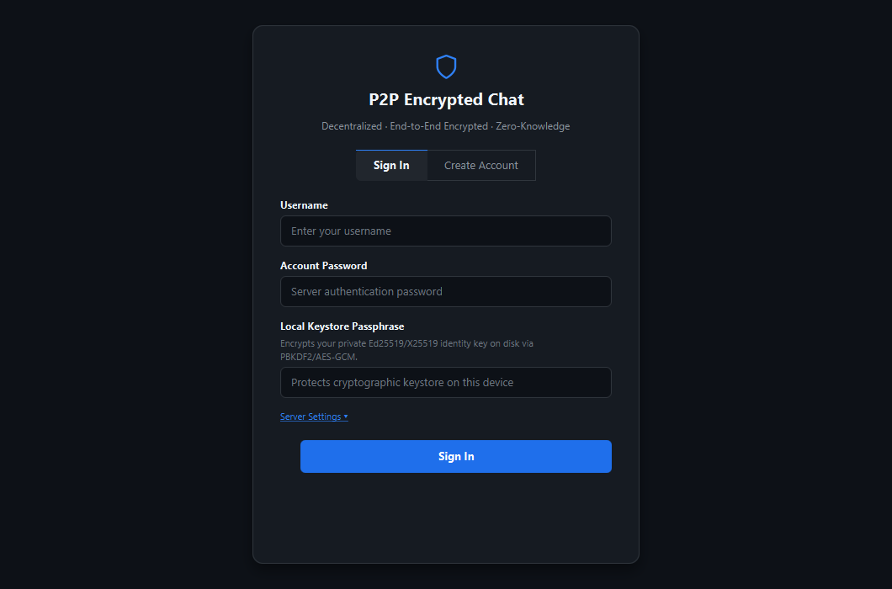
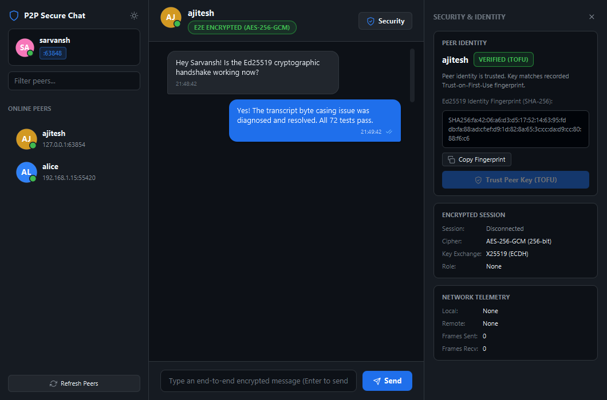
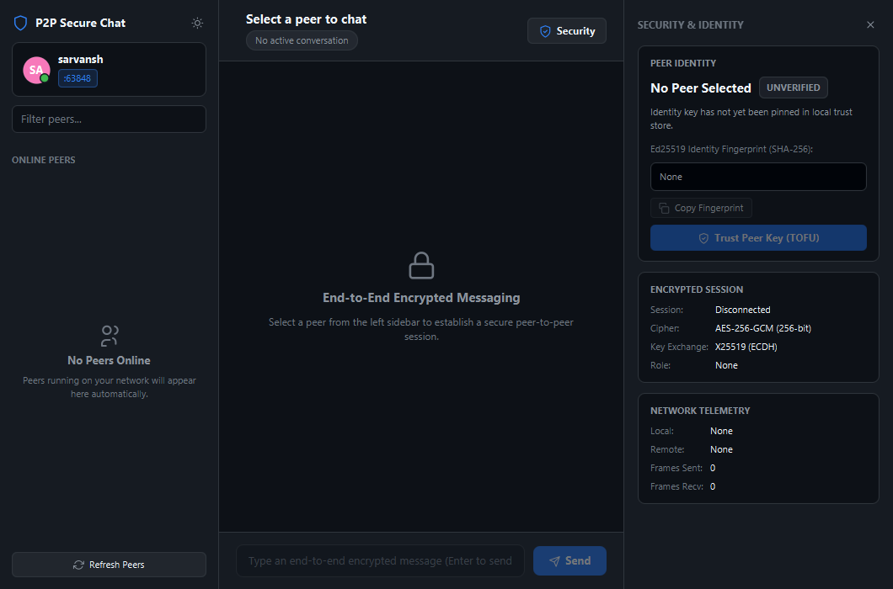
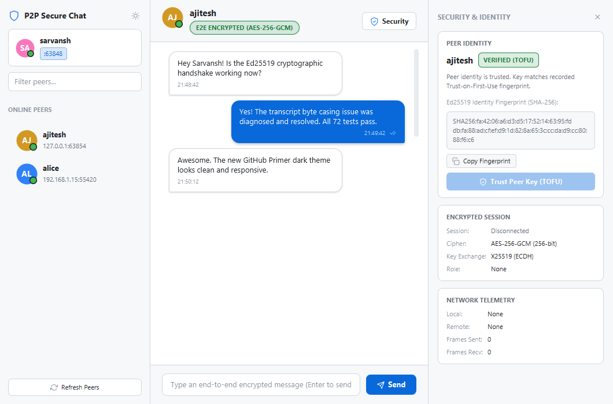
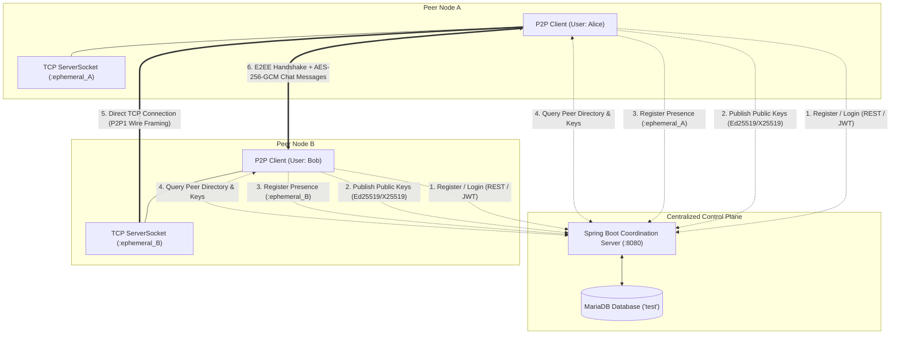
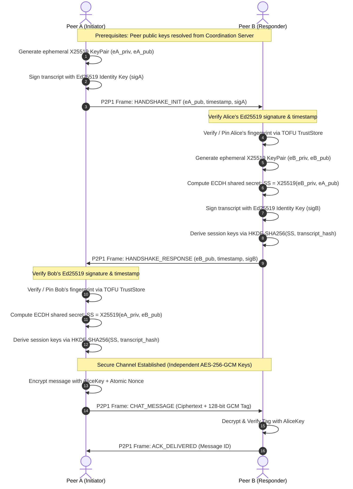

# P2P Messaging Chat Application with Encryption

[](https://adoptium.net/)
[](https://spring.io/projects/spring-boot)
[](https://openjfx.io/)
[](https://github.com/mkpaz/atlantafx)
[](https://mariadb.org/)
[](#automated-testing--quality-assurance)
[](#binary-wire-protocol-specification-p2p1)
[](#cryptographic--security-architecture)

A decentralized, end-to-end encrypted (E2EE) peer-to-peer desktop messaging application built in Java 21 for a Computer Networks project. The application utilizes a lightweight Spring Boot coordination server for user discovery and public-key registration, while executing all handshake negotiation, authenticated key exchange, and real-time chat communication directly between peers over raw binary TCP sockets.

---

## Table of Contents

- [1. Executive Summary](#1-executive-summary)
- [2. Core Features](#2-core-features)
- [3. Visual Tour & Screenshots](#3-visual-tour--screenshots)
- [4. Technology Stack](#4-technology-stack)
- [5. System Architecture & Network Topology](#5-system-architecture--network-topology)
- [6. Cryptographic & Security Architecture](#6-cryptographic--security-architecture)
- [7. Binary Wire Protocol Specification (`P2P1`)](#7-binary-wire-protocol-specification-p2p1)
- [8. Prerequisites & System Requirements](#8-prerequisites--system-requirements)
- [9. MariaDB Database Configuration](#9-mariadb-database-configuration)
- [10. Building the Multi-Module Project](#10-building-the-multi-module-project)
- [11. Running the Coordination Server](#11-running-the-coordination-server)
- [12. Running Peer Clients](#12-running-peer-clients)
  - [Scenario A: Local Loopback Testing (Single PC)](#scenario-a-local-loopback-testing-single-pc)
  - [Scenario B: Local Area Network (LAN) Testing (Two PCs)](#scenario-b-local-area-network-lan-testing-two-pcs)
- [13. Step-by-Step User Guide](#13-step-by-step-user-guide)
- [14. Configuration Reference](#14-configuration-reference)
- [15. Coordination Server REST API Reference](#15-coordination-server-rest-api-reference)
- [16. Automated Testing & Quality Assurance](#16-automated-testing--quality-assurance)
- [17. Threat Model & Security Analysis](#17-threat-model--security-analysis)
- [18. Troubleshooting & FAQ](#18-troubleshooting--faq)
- [19. Project Repository Structure](#19-project-repository-structure)
- [20. Academic Context & License](#20-academic-context--license)

---

## 1. Executive Summary

Traditional instant messaging platforms rely on centralized servers that route, inspect, and store message traffic. In contrast, this **P2P Encrypted Chat Application** implements a **hybrid decentralized architecture** specifically tailored to illustrate core Computer Networks principles:

1. **Separation of Control Plane and Data Plane:**
   - **Control Plane (Coordination Server):** A stateless Spring Boot REST service backed by MariaDB. It acts solely as an identity registry, directory service for public keys, and presence tracker (reporting which peers are online and on what IP/port).
   - **Data Plane (Direct P2P TCP Sockets):** All chat messages, delivery receipts, read receipts, and session handshakes travel **directly between peer machines** over raw TCP sockets. The coordination server **never touches, routes, or stores message ciphertext or plaintext**.
2. **Zero-Knowledge Architecture:**
   - The central coordination server has no access to private identity keys, ephemeral session keys, or message contents.
   - Message confidentiality, integrity, and authenticity are guaranteed end-to-end between peer clients.
3. **Custom Binary Wire Protocol (`P2P1`):**
   - Implements custom binary framing with fixed-width 24-byte headers, sequence counters, header CRC32 error detection, and strict payload length boundaries to prevent memory exhaustion attacks.
4. **Deterministic Connection Arbitration:**
   - Solves the classic P2P "simultaneous-connect" race condition through lexicographical username ordering, ensuring deterministic client/server socket roles during simultaneous peer connection attempts.

---

## 2. Core Features

- **End-to-End Cryptography (E2EE):**
  - **Ed25519:** 256-bit elliptic curve digital signature algorithm for identity verification and handshake transcript authentication.
  - **X25519 (ECDH):** Ephemeral Diffie-Hellman key agreement providing fresh keying material for every peer session.
  - **HKDF-SHA256:** HMAC-based Extract-and-Expand Key Derivation Function deriving independent symmetric encryption keys for initiator and responder directions.
  - **AES-256-GCM:** Authenticated symmetric encryption with 256-bit keys, unique 96-bit nonces (enforced via 64-bit atomic counters), 128-bit authentication tags, and Additional Authenticated Data (AAD) binding message metadata.
- **Trust-On-First-Use (TOFU) Identity Pinning:**
  - Client calculates deterministic SHA-256 fingerprints of peer Ed25519 identity keys.
  - Fingerprints are pinned in a local persistent trust store (`~/.p2p_chat/truststore.properties`).
  - Active UI indicators display trust states: `NEW`, `VERIFIED`, or `MISMATCH` (alerting the user to potential Man-in-the-Middle attacks).
- **Encrypted Local Keystore at Rest:**
  - Client private identity keys are never stored in plaintext. Keystores (`~/.p2p_chat/keys/<username>.keystore`) are encrypted using AES-256-GCM with keys derived from a user-supplied passphrase using PBKDF2-HMAC-SHA256 (600,000 iterations and 16-byte cryptographically secure salt).
- **Application-Layer TCP Protocol (`P2P1`):**
  - Big-endian binary wire framing with fixed 24-byte header.
  - Support for 8 distinct protocol message types (`HANDSHAKE_INIT`, `HANDSHAKE_RESPONSE`, `CHAT_MESSAGE`, `ACK_DELIVERED`, `ACK_READ`, `PING`, `PONG`, `DISCONNECT`).
  - Header CRC32 checksum for early detection of bit-flips and corrupted packets.
  - Defensive streaming reader enforcing a strict 16 MB maximum payload limit.
- **Reliable Message Delivery Tracking:**
  - Monotonic 64-bit sequence counters.
  - End-to-end delivery acknowledgments (`ACK_DELIVERED`) and read receipts (`ACK_READ`).
  - Visual status checkmarks: Sent (`✓`), Delivered (`✓✓` grey), Read (`✓✓` blue).
- **Deterministic Peer Connection Arbitration:**
  - Eliminates dual-connection socket deadlocks when two peers simultaneously attempt to open TCP connections to each other.
- **Modern Desktop UI (GitHub Primer Design System):**
  - Built with JavaFX 21 and styled using AtlantaFX (Primer Dark and Primer Light palettes).
  - Split-pane layout with responsive collapsible panels, peer directory, conversation stream, security inspector, and network diagnostics drawer.
  - Vector SVG icons for crisp scaling across high-DPI displays.
- **Centralized Coordination & Discovery:**
  - Spring Boot REST API with Spring Security and BCrypt password hashing.
  - RFC 7519 compliant JSON Web Token (JJWT) session tokens with 24-hour expiration.
  - Automatic MariaDB database creation and schema management (`test` database).
  - Background presence heartbeats with TTL expiration.

---

## 3. Visual Tour & Screenshots

The user interface adopts GitHub's Primer design language, emphasizing clarity, typographic rhythm, and explicit security indicators.

| Authentication & Keystore Setup | Active Encrypted Conversation |
| :---: | :---: |
|  |  |
| *Sign-in screen featuring local keystore passphrase protection and server settings.* | *Active conversation showing TOFU verification badge, delivery checks, and security metadata.* |

| Primer Dark Theme | Primer Light Theme |
| :---: | :---: |
|  |  |
| *Full interface with peer directory, conversation pane, and diagnostics.* | *Clean light theme with high contrast and vector typography.* |

---

## 4. Technology Stack

The project is structured as a multi-module Gradle project targeting **Java 21 LTS**.

| Module | Subsystem / Layer | Technology / Library | Version | Responsibility |
| :--- | :--- | :--- | :--- | :--- |
| **`p2p-common`** | Binary Protocol | Java NIO / ByteStreams | Java 21 | Binary wire framing (`P2P1`), CRC32 verification, stream parsing. |
| **`p2p-common`** | Cryptography | Java Cryptography Architecture (JCA) | Java 21 | Ed25519 signatures, X25519 ECDH, HKDF-SHA256, AES-256-GCM. |
| **`p2p-common`** | Networking Primitives | `java.net.Socket`, `ServerSocket` | Java 21 | Direct peer socket connections, listener threads, message tracking. |
| **`p2p-server`** | Web Framework | Spring Boot WebMVC | 4.1.1 | REST controllers for auth, public keys, and peer presence. |
| **`p2p-server`** | Security & Auth | Spring Security + BCrypt | 4.1.1 | Password hashing and HTTP security filter chains. |
| **`p2p-server`** | JWT Management | JJWT (`jjwt-api`, `jjwt-impl`, `jjwt-jackson`) | 0.12.6 | HMAC-SHA256 signed bearer access tokens (RFC-7519). |
| **`p2p-server`** | Persistence & ORM | Spring Data JPA / Hibernate | 4.1.1 | Entity mapping, transactions, and relational queries. |
| **`p2p-server`** | Database Driver | MariaDB Java Client | Latest | JDBC connectivity to MariaDB Server (`test` database). |
| **`p2p-client`** | Desktop UI | JavaFX (`base`, `graphics`, `controls`, `fxml`) | 21.0.6 | Modern reactive desktop user interface. |
| **`p2p-client`** | Design System | AtlantaFX (`atlantafx-base`) | 2.1.0 | GitHub Primer Dark & Light CSS component themes. |
| **`p2p-client`** | REST Client | `java.net.http.HttpClient` + Jackson | 2.18.2 | Asynchronous non-blocking HTTP calls to coordination server. |
| **Root** | Build Tool | Gradle Wrapper | 8.x | Multi-module compilation, dependency resolution, test execution. |

---

## 5. System Architecture & Network Topology

The architecture strictly decouples the centralized REST directory from the decentralized peer socket mesh.



### Traffic Separation

- **Control Plane Traffic (HTTP/1.1 REST):**
  - Authentication (Registration & Login).
  - Public Key Distribution (Ed25519 Identity Public Keys & X25519 Base Public Keys).
  - Dynamic Peer Discovery (Reporting local IP & listening port, polling online peers, heartbeats).
- **Data Plane Traffic (Raw TCP Socket):**
  - Cryptographic Session Handshake (`HANDSHAKE_INIT`, `HANDSHAKE_RESPONSE`).
  - Encrypted Chat Messages (`CHAT_MESSAGE`).
  - Delivery and Read Acknowledgments (`ACK_DELIVERED`, `ACK_READ`).
  - Liveness Keep-Alives (`PING`, `PONG`).
  - Clean Teardown (`DISCONNECT`).

---

## 6. Cryptographic & Security Architecture

The cryptographic implementation uses standard modern algorithms provided by the Java 21 standard library without external native dependencies.



### Cryptographic Primitives Breakdown

1. **Identity Signatures (Ed25519):**
   - Each client generates an Ed25519 keypair upon account creation.
   - The public key is published to the coordination server directory.
   - Handshake packets are signed by the sender's Ed25519 private key to prevent spoofing.
2. **Ephemeral Key Agreement (X25519):**
   - For every new TCP connection session, both peers generate fresh ephemeral X25519 keypairs.
   - Diffie-Hellman scalar multiplication computes a 32-byte raw shared secret.
3. **Key Derivation (HKDF-SHA256):**
   - The raw shared secret and a SHA-256 digest of the handshake transcript are passed into HKDF-Extract and HKDF-Expand (RFC 5869).
   - Generates two independent 256-bit symmetric keys:
     - `Initiator-to-Responder Key`
     - `Responder-to-Initiator Key`
   - Using directional keys ensures that compromising or replaying traffic in one direction cannot compromise the reverse direction.
4. **Symmetric Encryption (AES-256-GCM):**
   - 256-bit AES encryption in Galois/Counter Mode (GCM).
   - 12-byte (96-bit) IV constructed with a monotonic 64-bit atomic counter to guarantee nonce uniqueness.
   - 128-bit GCM authentication tag verifies ciphertext integrity.
   - Associated Authenticated Data (AAD) binds the message ID, sender username, and recipient username to the ciphertext, preventing message relocation or cross-session replay.
5. **Trust-On-First-Use (TOFU) Identity Pinning:**
   - Identity fingerprint is the uppercase hex encoding of `SHA-256(Ed25519_PublicKey_Bytes)`.
   - On first contact with a peer, the fingerprint is pinned in `~/.p2p_chat/truststore.properties`.
   - Subsequent connections compare the server-provided key against the pinned fingerprint. A change triggers a `MISMATCH` security alert in the UI.
6. **Keystore Protection at Rest:**
   - Client private keys are stored locally at `~/.p2p_chat/keys/<username>.keystore`.
   - The file is encrypted using AES-256-GCM with a key derived from the user's keystore passphrase via PBKDF2-HMAC-SHA256 (600,000 iterations, 16-byte random salt).

---

## 7. Binary Wire Protocol Specification (`P2P1`)

All direct peer socket communication uses a custom binary protocol.

### 24-Byte Header Wire Layout

Numbers are transmitted in **Network Byte Order (Big-Endian)**.

```text
 0                   1                   2                   3
 0 1 2 3 4 5 6 7 8 9 0 1 2 3 4 5 6 7 8 9 0 1 2 3 4 5 6 7 8 9 0 1
+-+-+-+-+-+-+-+-+-+-+-+-+-+-+-+-+-+-+-+-+-+-+-+-+-+-+-+-+-+-+-+-+
|                     Magic Bytes ('P2P1')                      |
+-+-+-+-+-+-+-+-+-+-+-+-+-+-+-+-+-+-+-+-+-+-+-+-+-+-+-+-+-+-+-+-+
|    Version    | Message Type  |             Flags             |
+-+-+-+-+-+-+-+-+-+-+-+-+-+-+-+-+-+-+-+-+-+-+-+-+-+-+-+-+-+-+-+-+
|                                                               |
+                     Sequence Number (64-bit)                  +
|                                                               |
+-+-+-+-+-+-+-+-+-+-+-+-+-+-+-+-+-+-+-+-+-+-+-+-+-+-+-+-+-+-+-+-+
|                        Payload Length                         |
+-+-+-+-+-+-+-+-+-+-+-+-+-+-+-+-+-+-+-+-+-+-+-+-+-+-+-+-+-+-+-+-+
|                       Header CRC32                            |
+-+-+-+-+-+-+-+-+-+-+-+-+-+-+-+-+-+-+-+-+-+-+-+-+-+-+-+-+-+-+-+-+
|                     Payload (Variable Length)                 |
|                               ...                             |
+-+-+-+-+-+-+-+-+-+-+-+-+-+-+-+-+-+-+-+-+-+-+-+-+-+-+-+-+-+-+-+-+
```

### Header Field Specification

| Offset (Bytes) | Field Name | Data Type | Value / Description |
| :--- | :--- | :--- | :--- |
| **0 – 3** | Magic Bytes | `uint32` (4 bytes) | `0x50325031` (ASCII string `"P2P1"`). Used for frame synchronization. |
| **4** | Protocol Version | `uint8` (1 byte) | Current version: `0x01`. Frames with unsupported versions are rejected. |
| **5** | Message Type | `uint8` (1 byte) | Identifier defining payload semantics (see table below). |
| **6 – 7** | Flags | `uint16` (2 bytes) | Reserved for protocol extensions (default: `0x0000`). |
| **8 – 15** | Sequence Number | `uint64` (8 bytes) | Monotonically increasing message sequence ID. |
| **16 – 19** | Payload Length | `uint32` (4 bytes) | Length of following payload in bytes. Maximum allowed: 16 MB. |
| **20 – 23** | Header CRC32 | `uint32` (4 bytes) | Standard CRC32 checksum computed over bytes 0 through 19. |

> [!NOTE]
> **Role of CRC32:** The CRC32 checksum covers only the 20-byte header preamble to quickly detect physical link bit-flips and framing misalignment before allocating memory for the payload. Cryptographic authenticity is enforced by the AES-256-GCM authentication tag on the payload.

### Protocol Message Types

| Value | Identifier | Payload Format | Description |
| :---: | :--- | :--- | :--- |
| `0x01` | `HANDSHAKE_INIT` | Ephemeral X25519 PubKey + Timestamp + Ed25519 Signature | Initiates cryptographic session negotiation. |
| `0x02` | `HANDSHAKE_RESPONSE` | Ephemeral X25519 PubKey + Timestamp + Ed25519 Signature | Completes session key agreement. |
| `0x03` | `CHAT_MESSAGE` | Encrypted JSON payload (AES-256-GCM) | User chat text, timestamp, and message ID. |
| `0x04` | `ACK_DELIVERED` | UTF-8 Message UUID string | Confirms socket receipt of a message. |
| `0x05` | `ACK_READ` | UTF-8 Message UUID string | Confirms recipient has viewed the message. |
| `0x06` | `PING` | Empty or timestamp | Liveness probe sent over idle connections. |
| `0x07` | `PONG` | Echo payload | Reply to liveness probe. |
| `0x08` | `DISCONNECT` | Optional UTF-8 reason string | Graceful session teardown notification. |
| `0xFF` | `FRAME_ERROR` | UTF-8 diagnostic error message | Framing or decoding failure alert. |

---

## 8. Prerequisites & System Requirements

Ensure the following prerequisites are met prior to building:

1. **Java Development Kit (JDK):**
   - **Java 21 LTS** (Eclipse Temurin, Oracle OpenJDK, or Amazon Corretto).
   - Verify by running:
     ```powershell
     java -version
     ```
2. **Database Management System:**
   - **MariaDB Server 10.5+** or **11.x**.
   - Running locally on port `3306`.
3. **Operating System:**
   - Windows 10/11, macOS, or Linux.
   - Native commands in this guide are provided for **Windows PowerShell**.
4. **Display:**
   - Minimum screen resolution: 1024x768 (UI is optimized for 1060x700).

---

## 9. MariaDB Database Configuration

The coordination server requires access to a MariaDB database named `test`.

### 1. Database Creation & Verification

The server JDBC connection string includes `createDatabaseIfNotExist=true`. However, you can verify or create the database manually using the MariaDB CLI:

```sql
-- Connect to MariaDB
mariadb -u root -p

-- Check if the 'test' database exists; create it if absent
CREATE DATABASE IF NOT EXISTS test CHARACTER SET utf8mb4 COLLATE utf8mb4_unicode_ci;

-- Confirm database presence
SHOW DATABASES LIKE 'test';
```

### 2. Configuration Parameters

The database connection is configured in `p2p-server/src/main/resources/application.properties`:

```properties
spring.datasource.url=jdbc:mariadb://${DB_HOST:localhost}:${DB_PORT:3306}/${DB_NAME:test}?createDatabaseIfNotExist=true
spring.datasource.username=${DB_USERNAME:root}
spring.datasource.password=${DB_PASSWORD:1234}
spring.datasource.driver-class-name=org.mariadb.jdbc.Driver

# JPA Schema Management ('update' safe mode)
spring.jpa.hibernate.ddl-auto=update
spring.jpa.properties.hibernate.dialect=org.hibernate.dialect.MariaDBDialect
```

### 3. Setting Custom Credentials (Optional)

If your MariaDB `root` password is not `1234`, set environment variables before launching:

```powershell
$env:DB_USERNAME = "root"
$env:DB_PASSWORD = "YOUR_ACTUAL_PASSWORD"
$env:DB_PORT = "3306"
```

---

## 10. Building the Multi-Module Project

The project is built using the provided Gradle wrapper.

### Build All Modules

Open PowerShell in the project root directory:

```powershell
.\gradlew.bat clean build -x test
```

### Run the Full Automated Test Suite

To run all 75 automated unit and integration tests:

```powershell
.\gradlew.bat test
```

---

## 11. Running the Coordination Server

The coordination server manages authentication, public-key storage, and online presence discovery.

### Launch Server

From the project root:

```powershell
.\gradlew.bat :p2p-server:bootRun
```

### Verify Server Health

Once the console displays `Started P2pApplication in ... seconds`, test the health endpoint:

```powershell
curl.exe http://localhost:8080/api/health
```

Expected response:
```json
{"status":"UP","timestamp":1729350000000}
```

---

## 12. Running Peer Clients

### Scenario A: Local Loopback Testing (Single PC)

This scenario runs two independent client instances on the same machine communicating over `127.0.0.1`.

#### 1. Start Client Instance 1 (Alice)
Open a new PowerShell terminal:
```powershell
cd "c:\Users\sarva\Downloads\CN Project\p2p"
.\gradlew.bat :p2p-client:run
```
- In the client window, click **Create Account**.
- **Username:** `Alice`
- **Account Password:** `Password123!`
- **Keystore Passphrase:** `KeyPassAlice123!`
- Click **Create Account**. Alice will register, generate her keys, bind to an ephemeral TCP port (e.g., `54123`), and appear online.

#### 2. Start Client Instance 2 (Bob)
Open a second PowerShell terminal:
```powershell
cd "c:\Users\sarva\Downloads\CN Project\p2p"
.\gradlew.bat :p2p-client:run
```
- In the second client window, click **Create Account**.
- **Username:** `Bob`
- **Account Password:** `Password123!`
- **Keystore Passphrase:** `KeyPassBob123!`
- Click **Create Account**. Bob will register, bind to an ephemeral port (e.g., `54124`), and appear online.

#### 3. Establish Peer Session
- In Alice's window, click **Bob** in the Online Peers sidebar.
- Click **Start Chat / Connect**.
- The clients perform the automated connection arbitration, complete the X25519/Ed25519 cryptographic handshake, pin fingerprints via TOFU, and transition the session to `VERIFIED`.
- Send messages back and forth. Notice delivery checkmarks (`✓✓`) updating in real-time.

---

### Scenario B: Local Area Network (LAN) Testing (Two PCs)

To run the application between two physical computers on the same Wi-Fi/Ethernet network:

#### 1. Identify Host Machine IP Address
On Computer 1 (running the Coordination Server and Client 1):
```powershell
ipconfig
```
Locate the IPv4 Address under your active Wi-Fi or Ethernet adapter (e.g., `192.168.1.50`).

#### 2. Configure Windows Defender Firewall
Ensure inbound connections on the coordination server port (`8080`) and dynamic peer ports (`50000-65535`) are permitted:

```powershell
# Run PowerShell as Administrator on Computer 1
New-NetFirewallRule -DisplayName "P2P Coordination Server" -Direction Inbound -LocalPort 8080 -Protocol TCP -Action Allow
New-NetFirewallRule -DisplayName "P2P Peer Direct Sockets" -Direction Inbound -LocalPort 50000-65535 -Protocol TCP -Action Allow
```

#### 3. Run Server on Computer 1
```powershell
.\gradlew.bat :p2p-server:bootRun
```

#### 4. Launch Clients on Both Machines
- Launch Client 1 on Computer 1:
  ```powershell
  .\gradlew.bat :p2p-client:run
  ```
- Launch Client 2 on Computer 2:
  ```powershell
  .\gradlew.bat :p2p-client:run
  ```
- On **Computer 2's sign-in screen**, click **Server Settings ▾**.
- Change the **Coordination Server URL** from `http://localhost:8080` to `http://192.168.1.50:8080`.
- Register/Login on both computers.
- Peers will discover each other's LAN IP addresses through the coordination server and establish direct TCP socket connections for encrypted chat.

---

## 13. Step-by-Step User Guide

### 1. Authentication & Local Keystore Setup
- **Account Creation:** Enter a username and password. Enter a keystore passphrase to encrypt your Ed25519/X25519 private keys locally on disk.
- **Sign In:** On subsequent launches, signing in with the same username and passphrase decrypts the local keystore.

### 2. Peer Discovery
- The left sidebar displays online peers registered with the coordination server.
- The client periodically pings the server to update its presence and fetch the latest online peer list.
- Click **Refresh** at any time to immediately poll the directory.

### 3. Initiating Chat & Connection Arbitration
- Select a peer from the list.
- Click **Start Chat / Connect**.
- If both peers attempt to connect at the exact same millisecond, the application executes **Connection Arbitration**:
  - The peer whose username is lexicographically lower acts as the TCP Client.
  - The peer whose username is lexicographically higher acts as the TCP Server.
  - This guarantees a single canonical socket connection without race conditions.

### 4. Identity Verification & TOFU
- Once the handshake completes, the peer badge in the header shows:
  - `VERIFIED` (Green): The peer's Ed25519 identity key matches the pinned fingerprint in `~/.p2p_chat/truststore.properties`.
  - `NEW IDENTITY` (Blue): First time contacting this peer; fingerprint has been saved.
  - `KEY MISMATCH` (Red): The received key does not match the pinned key. Chat is flagged to alert the user of possible impersonation.
- View the peer's full 64-character SHA-256 fingerprint in the **Security Inspector** side panel.

### 5. Chatting & Delivery Receipts
- Type a message and press **Enter** or click **Send**.
- Message tracking indicators update automatically:
  - `✓` (Grey): Message sent over the TCP socket.
  - `✓✓` (Grey): Delivery acknowledgment (`ACK_DELIVERED`) received from peer socket.
  - `✓✓` (Blue): Read acknowledgment (`ACK_READ`) received when peer focuses the window.

### 6. Diagnostics & Theme Switching
- **Security & Diagnostics Drawer:** Toggle the bottom drawer to view real-time socket statistics (sent/received frame counters, socket address, session cipher, last error).
- **Theme Toggle:** Click the Moon/Sun icon in the top header to seamlessly switch between GitHub Primer Dark and Primer Light themes.

---

## 14. Configuration Reference

The following environment variables and system properties can be used to customize runtime behavior:

| Variable / Property | Target Subsystem | Default Value | Description |
| :--- | :--- | :--- | :--- |
| `SERVER_PORT` | `p2p-server` | `8080` | HTTP port on which the coordination server listens. |
| `DB_HOST` | `p2p-server` | `localhost` | MariaDB server hostname or IP address. |
| `DB_PORT` | `p2p-server` | `3306` | MariaDB server port. |
| `DB_NAME` | `p2p-server` | `test` | Database name (fixed to `test` per project specs). |
| `DB_USERNAME` | `p2p-server` | `root` | MariaDB authentication username. |
| `DB_PASSWORD` | `p2p-server` | `1234` | MariaDB authentication password. |
| `JWT_SECRET` | `p2p-server` | *(Auto-generated 256-bit)* | HMAC-SHA256 signing key for JWT tokens. |
| `p2p.server.url` | `p2p-client` | `http://localhost:8080` | Default coordination server URL (also editable in UI). |
| `p2p.peer.port` | `p2p-client` | `0` (ephemeral) | Override specific TCP port for peer listener socket. |

---

## 15. Coordination Server REST API Reference

All protected endpoints require the HTTP header: `Authorization: Bearer <JWT_TOKEN>`.

### Authentication Endpoints

#### `POST /api/auth/register`
Creates a new user account and hashes the password with BCrypt.
- **Request Body:**
  ```json
  {
    "username": "Alice",
    "password": "Password123!"
  }
  ```
- **Responses:**
  - `201 Created`: User successfully registered.
  - `400 Bad Request`: Validation failure (short password, invalid username).
  - `409 Conflict`: Username already registered.

#### `POST /api/auth/login`
Authenticates user credentials and issues an RFC 7519 JWT access token.
- **Request Body:**
  ```json
  {
    "username": "Alice",
    "password": "Password123!"
  }
  ```
- **Responses:**
  - `200 OK`:
    ```json
    {
      "token": "eyJhbGciOiJIUzI1NiIsInR5cCI6IkpXVCJ9...",
      "username": "Alice"
    }
    ```
  - `401 Unauthorized`: Invalid credentials.

---

### Public Key Directory Endpoints

#### `POST /api/keys`
Publishes the authenticated user's public keys to the directory.
- **Auth Required:** Yes
- **Request Body:**
  ```json
  {
    "identityPublicKey": "MCowBQYDK2VwAyEA...",
    "keyAgreementPublicKey": "MCowBQYDK2VuAyEA...",
    "allowReplacement": true
  }
  ```
- **Responses:**
  - `200 OK`: Keys registered.
  - `400 Bad Request`: Malformed Base64 or unsupported key encoding.

#### `GET /api/keys/{username}`
Retrieves the published public keys for a specific peer.
- **Auth Required:** Yes
- **Responses:**
  - `200 OK`:
    ```json
    {
      "username": "Bob",
      "identityPublicKey": "MCowBQYDK2VwAyEA...",
      "keyAgreementPublicKey": "MCowBQYDK2VuAyEA...",
      "createdAt": "2026-10-19T18:00:00Z"
    }
    ```
  - `404 Not Found`: User or keys not found.

---

### Presence & Peer Discovery Endpoints

#### `POST /api/presence/register`
Registers the client's listening IP address and TCP port with the directory.
- **Auth Required:** Yes
- **Request Body:**
  ```json
  {
    "listeningPort": 54123
  }
  ```
- **Responses:**
  - `200 OK`: Presence registered.

#### `POST /api/presence/heartbeat`
Refreshes presence TTL to prevent session timeout.
- **Auth Required:** Yes
- **Request Body:** `{}`
- **Responses:**
  - `200 OK`: Presence refreshed.

#### `POST /api/presence/disconnect`
Explicitly removes the user from the active online peer list.
- **Auth Required:** Yes
- **Responses:**
  - `200 OK`: Presence removed.

#### `GET /api/presence/peers`
Retrieves a list of all currently online peers with their IP addresses and listening ports.
- **Auth Required:** Yes
- **Responses:**
  - `200 OK`:
    ```json
    [
      {
        "username": "Bob",
        "ipAddress": "127.0.0.1",
        "port": 54124,
        "lastSeen": "2026-10-19T18:30:00Z"
      }
    ]
    ```

---

### Health Endpoint

#### `GET /api/health`
Public liveness probe.
- **Auth Required:** No
- **Responses:**
  - `200 OK`: `{"status":"UP","timestamp":1729350000000}`

---

## 16. Automated Testing & Quality Assurance

The codebase contains a comprehensive automated test suite consisting of **75 passing tests** across unit, cryptographic, networking, framing, and integration domains.

```powershell
.\gradlew.bat test
```

### Test Suite Distribution

| Module | Test Classes | Test Count | Key Areas Covered |
| :--- | :--- | :---: | :--- |
| **`p2p-common`** | `ProtocolFrameTest`, `CryptoPrimitivesTest`, `FrameEncodingTest`, `MessageTrackerTest` | **22** | Header framing, CRC32 verification, Ed25519 signatures, X25519 ECDH, HKDF derivation, AES-256-GCM encryption/decryption, sequence counters. |
| **`p2p-server`** | `AuthControllerTest`, `KeyDirectoryTest`, `PeerDiscoveryTest`, `JwtProviderTest` | **33** | BCrypt authentication, JWT creation/validation, key registration, presence tracking, MariaDB/H2 JPA persistence, error handling. |
| **`p2p-client`** | `ClientKeyManagerTest`, `TrustStoreTest`, `EncryptedPeerSessionTest` | **20** | Keystore encryption/decryption via PBKDF2/AES-GCM, TOFU pinning, session state machine, handshake timeout handling. |
| **Total** | | **75** | **0 Failures, 0 Errors, 100% Pass Rate** |

---

## 17. Threat Model & Security Analysis

### In-Scope Security Guarantees

1. **Confidentiality Against Network Eavesdroppers:**
   - All message payloads are encrypted with AES-256-GCM. An attacker capturing raw TCP traffic sees only the 24-byte protocol header and randomized ciphertext.
2. **Integrity & Authenticity:**
   - The 128-bit GCM authentication tag guarantees that any modification to ciphertext or AAD metadata results in immediate packet rejection.
3. **Protection Against Server Compromise:**
   - The coordination server only stores public keys and password hashes. Even if the server database is completely compromised, past and future message traffic cannot be decrypted.
4. **Replay Attack Resistance:**
   - Each session maintains an independent sequence window. Replayed packets with duplicate sequence numbers or reused nonces are detected and discarded.
5. **Man-in-the-Middle (MITM) Resistance:**
   - Handshake messages are digitally signed using Ed25519 keys. The client pins peer identity fingerprints upon initial connection (TOFU), raising immediate alerts if a key changes.

### Limitations & Future Scope

- **Message Forward Secrecy:** Session keys are ephemeral per connection, but messages within a single long-lived TCP connection use ratchet counters under the same session key. Implementing the full Double Ratchet algorithm (Signal protocol) is planned for future iterations.
- **NAT Traversal:** Direct peer connections require routable IP addresses or port forwarding. STUN/TURN/ICE hole punching is not currently implemented.
- **Offline Messaging:** Messages cannot be delivered if the recipient peer is offline. Implementing an encrypted store-and-forward mailbox on the server is part of the future roadmap.

---

## 18. Troubleshooting & FAQ

### 1. MariaDB Access Denied Error
**Symptom:** `Access denied for user 'root'@'localhost'` during server startup.
**Solution:** Verify your MariaDB password. By default, the server expects `1234`. If your password differs, set the environment variable:
```powershell
$env:DB_PASSWORD = "your_actual_password"
.\gradlew.bat :p2p-server:bootRun
```

### 2. Peer Connection Refused
**Symptom:** Client log shows `java.net.ConnectException: Connection refused: connect`.
**Causes & Fixes:**
- The remote peer may not have started their listener socket yet. Wait a few seconds and retry.
- In LAN testing, ensure Windows Firewall allows incoming connections on the dynamic port range (see [LAN Testing section](#scenario-b-local-area-network-lan-testing-two-pcs)).

### 3. Handshake Signature Error
**Symptom:** Diagnostics log displays `Invalid Ed25519 handshake signature from <peer>`.
**Fix:**
- Ensure both clients are pointing to the same Coordination Server instance.
- If an account was deleted and recreated on the server, delete the stale local trust store at `~/.p2p_chat/truststore.properties`.

### 4. JavaFX Graphical Issues on Linux/Wayland
**Fix:** Set the Prism rendering pipeline to software or GTK3:
```bash
export GDK_BACKEND=x11
./gradlew :p2p-client:run
```

---

## 19. Project Repository Structure

```text
p2p/
├── build.gradle                          # Root Gradle build script (Java 21, toolchains)
├── settings.gradle                       # Multi-module declarations
├── gradlew.bat / gradlew                 # Gradle wrappers
├── docs/
│   └── images/                           # Application screenshots for documentation
│       ├── active-chat.png
│       ├── auth-view.png
│       ├── main-chat-dark.png
│       └── main-chat-light.png
│
├── p2p-common/                           # Shared binary protocol & crypto primitives
│   ├── build.gradle
│   └── src/
│       ├── main/java/com/project/p2p/common/
│       │   ├── ProtocolConstants.java   # Framing constants, magic bytes, port defaults
│       │   ├── crypto/                  # Cryptographic engine
│       │   │   ├── CryptoPrimitives.java# Ed25519, X25519, AES-256-GCM implementations
│       │   │   ├── Hkdf.java            # RFC 5869 HKDF-SHA256 implementation
│       │   │   ├── EncryptedPayload.java# Ciphertext and IV container
│       │   │   ├── HandshakePayload.java# Key agreement DTOs
│       │   │   └── SessionKeys.java     # Directional symmetric key container
│       │   ├── network/                 # Raw socket networking & tracking
│       │   │   ├── PeerServer.java      # Listening TCP ServerSocket
│       │   │   ├── PeerClient.java      # Outbound TCP Socket
│       │   │   ├── PeerConnection.java  # Active socket duplex wrapper
│       │   │   └── MessageTracker.java  # Delivery/read state machine
│       │   └── protocol/                # Wire framing & codecs
│       │       ├── ProtocolFrame.java   # 24-byte header DTO
│       │       ├── FrameEncoder.java    # Serialization to byte buffers
│       │       ├── FrameDecoder.java    # Deserialization from byte buffers
│       │       ├── FrameStreamReader.java # Streaming socket frame reader
│       │       └── MessageType.java     # Protocol message type enum
│       └── test/java/                   # 22 protocol and crypto unit tests
│
├── p2p-server/                           # Centralized Coordination Server
│   ├── build.gradle
│   └── src/
│       ├── main/
│       │   ├── java/com/project/p2p/
│       │   │   ├── P2pApplication.java  # Spring Boot main entry point
│       │   │   ├── config/              # Spring Security & Web configuration
│       │   │   ├── controller/          # REST endpoints (Auth, Keys, Presence, Health)
│       │   │   ├── dto/                 # Request/Response payloads
│       │   │   ├── model/               # JPA entities (User, UserKey, PeerSession)
│       │   │   ├── repository/          # Spring Data JPA repositories
│       │   │   ├── security/            # JWT Filter, TokenProvider, BCrypt
│       │   │   └── service/             # Business logic layer
│       │   └── resources/
│       │       └── application.properties # MariaDB and server configuration
│       └── test/java/                   # 33 controller, service, and security tests
│
└── p2p-client/                           # JavaFX Desktop Client
    ├── build.gradle
    └── src/
        ├── main/
        │   ├── java/com/project/p2p/client/
        │   │   ├── P2pClientLauncher.java# JavaFX bootstrapper
        │   │   ├── P2pClientApp.java    # Primary Application lifecycle
        │   │   ├── crypto/              # Keystore encryption and TOFU TrustStore
        │   │   ├── model/               # Client-side domain models
        │   │   ├── network/             # Encrypted peer session management
        │   │   ├── service/             # Async HTTP client for coordination server
        │   │   └── ui/                  # UI Views & Components
        │   │       ├── AuthView.java    # Login, Registration & Keystore Setup
        │   │       ├── MainChatView.java# Primary split-pane conversation view
        │   │       ├── PeerInfoPanel.java# Security inspector & fingerprint panel
        │   │       ├── common/          # Vector SVG icons and ThemeManager
        │   │       └── ...
        │   └── resources/
        │       └── styles/              # Primer theme CSS overrides
        └── test/java/                   # 20 keystore, truststore, and session tests
```

---

## 20. Academic Context & License

This project was developed for an academic Computer Networks course, demonstrating:
- Custom application-layer protocol design over transport-layer TCP sockets.
- Practical implementation of state-of-the-art cryptographic handshakes and authenticated encryption.
- Robust handling of distributed network edge-cases (simultaneous connect, framing errors, bit corruption).
- Software engineering best practices including clean multi-module architecture, separation of concerns, and automated testing.

### License

This project is licensed under the **MIT License** - see below for details:

```text
MIT License

Copyright (c) 2026 Sarvansh

Permission is hereby granted, free of charge, to any person obtaining a copy
of this software and associated documentation files (the "Software"), to deal
in the Software without restriction, including without limitation the rights
to use, copy, modify, merge, publish, distribute, sublicense, and/or sell
copies of the Software, and to permit persons to whom the Software is
furnished to do so, subject to the following conditions:

The above copyright notice and this permission notice shall be included in all
copies or substantial portions of the Software.

THE SOFTWARE IS PROVIDED "AS IS", WITHOUT WARRANTY OF ANY KIND, EXPRESS OR
IMPLIED, INCLUDING BUT NOT LIMITED TO THE WARRANTIES OF MERCHANTABILITY,
FITNESS FOR A PARTICULAR PURPOSE AND NONINFRINGEMENT. IN NO EVENT SHALL THE
AUTHORS OR COPYRIGHT HOLDERS BE LIABLE FOR ANY CLAIM, DAMAGES OR OTHER
LIABILITY, WHETHER IN AN ACTION OF CONTRACT, TORT OR OTHERWISE, ARISING FROM,
OUT OF OR IN CONNECTION WITH THE SOFTWARE OR THE USE OR OTHER DEALINGS IN THE
SOFTWARE.
```
